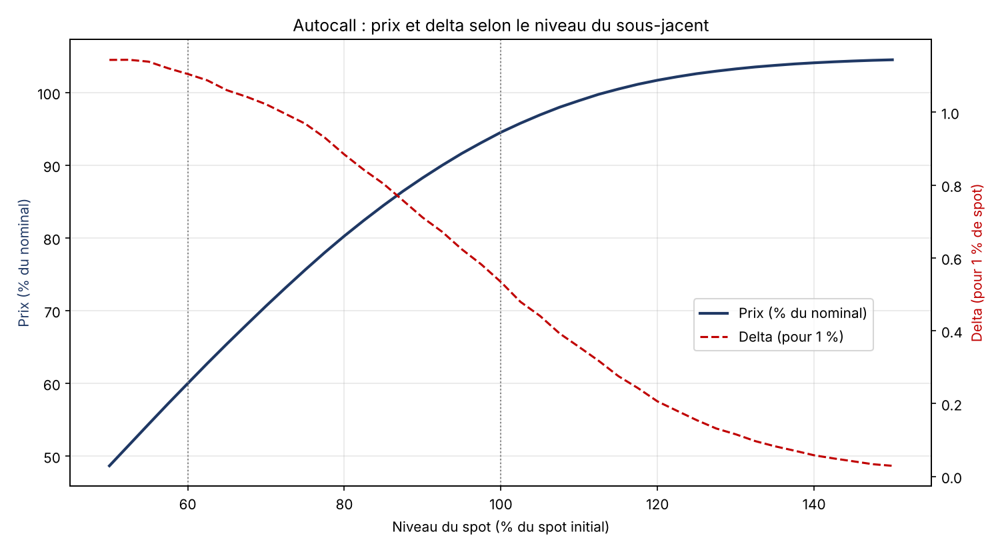

# Autocall Pricer (Monte Carlo, Black-Scholes)

Prices a 5-year Athena autocall on an equity index with memory coupon and 60% European capital protection barrier.



- Exact simulation at annual observation dates under Black-Scholes
- Outputs: price, autocall probability per date, expected life, probability of capital loss
- Greeks by bump-and-revalue with common random numbers: delta, gamma, vega, dividend sensitivity, rho
- Validation: with autocall and coupon switched off, the Monte Carlo price matches the closed-form decomposition (zero-coupon − put − digital put)

Product and market parameters are set at the top of `pricer_autocall.py`.

```bash
pip install -r requirements.txt
python pricer_autocall.py
```

Code comments are in French.
