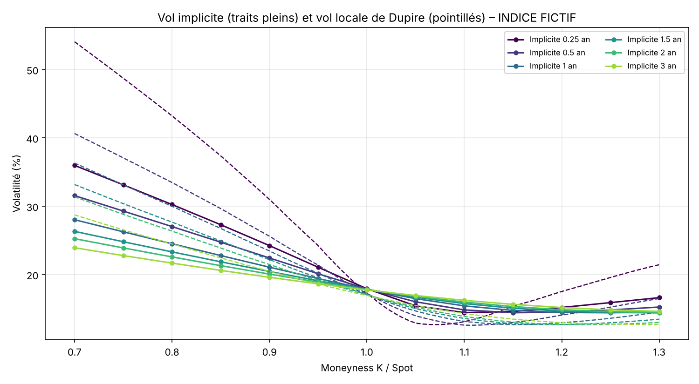
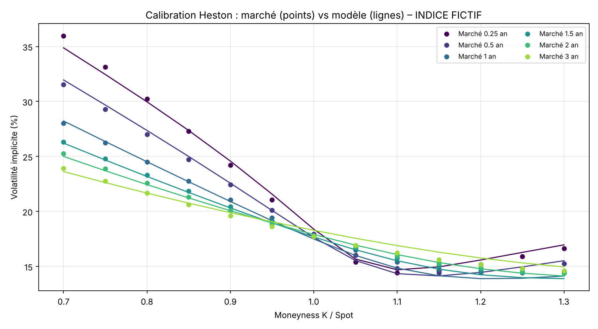

# Local & Stochastic Volatility Models

Two volatility models calibrated on an equity implied volatility surface, each with a Monte Carlo check.

| Model | Script | What it does | Check |
|---|---|---|---|
| Dupire local volatility | `vol_locale_dupire.py` | Builds σ_loc(S, t) from the implied surface (Gatheral's total-variance formula) | MC repricing recovers the input surface within ~0.15 vol pts |
| Heston stochastic volatility | `vol_stochastique_heston.py` | Semi-closed-form pricing (characteristic function) and vega-weighted calibration of κ, θ, ξ, ρ, v0 | Closed form vs full-truncation Euler MC |




## Input file

Create `surface_vol_implicite.xlsx` in the folder set by `DOSSIER_DONNEES` in `commun.py`:

- `Parametres`: B2 underlying, B3 valuation date, B4 spot, B5 risk-free rate, B6 dividend yield
- `Vol_Implicite`: moneyness K/S in row 1 (from B1), maturities in years in column A (from A2), implied vols in the grid

## Run

```bash
pip install -r requirements.txt
python vol_locale_dupire.py --demo
python vol_stochastique_heston.py --demo
```

`--demo` uses a synthetic arbitrage-free SSVI surface. Code comments are in French.
